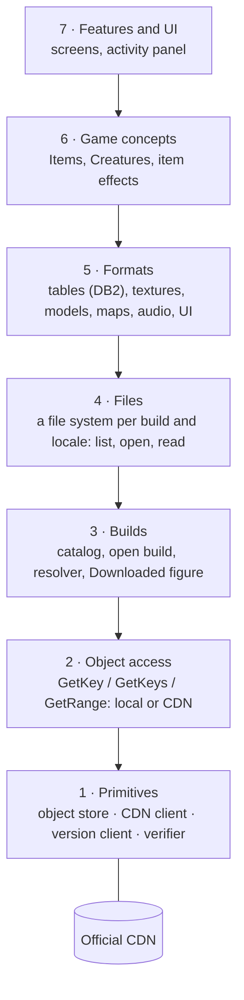
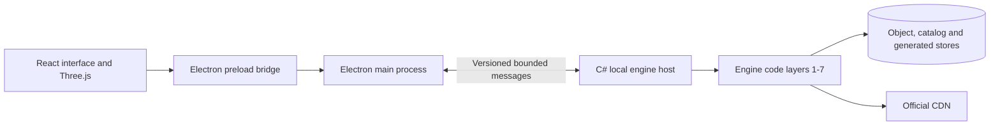

# VibeMiner architecture

VibeMiner has a browser-based desktop interface and one application-owned C# engine. The engine is a modular monolith. Do not add a service framework, network server, event bus or plugin framework without an actual need.

The storage rewrite ([#153](https://github.com/aircan80/vibeminer/issues/153)–[#160](https://github.com/aircan80/vibeminer/issues/160), [#162](https://github.com/aircan80/vibeminer/issues/162)) is rebuilding the engine in seven code layers. In the target design, each layer depends only on the layers below it and every layer boundary is an interface. [Code layers](#code-layers) describes that target, and the slice column says where each part lands. None of it is on `main` yet. Sections marked **Current** describe today's code, which those slices replace.

## Code layers

**Planned.** This is the target structure; each row lands with the slice named.

| Layer | Owns | Typical calls | Knows about | Interfaces | Slice |
| --- | --- | --- | --- | --- | --- |
| 1 · Primitives | The object store (packs, index, history log; a full portable spec, `docs/formats/object-store-v1.md`, arrives with #153); the CDN client (fetch one key or byte range, check the reply); the version-service client; per-key-type verification | `HasAsync`, `ReadAsync`, `ReadRangeAsync`, `PutAsync`, `FetchRange` | Keys, bytes, HTTP. Nothing about builds, and no choice between local and CDN | `IObjectReader`, `IObjectWriter`, `IHistoryLog`, `IObjectStoreMaintenance`, `IObjectVerifier`, `ICdnClient`, `IVersionClient` | #153, #154 |
| 2 · Object access | The only place that decides local or CDN. Checks the store (and the shared dev store for QA), plans merged ranges for what is missing, calls the CDN client, stores verified results and returns them | `GetKey`, `GetKeys`, `GetRange` | Keys plus a CDN context (hosts, path, CDN config) | `IObjectSource` | #154 |
| 3 · Builds | The catalog built from the history log, opened builds, build metadata, the FileDataID → EKey resolver, the Downloaded figure | `ListBuilds`, `OpenBuild`, `ResolveFile(build, id)`, `Downloaded(build)` | Builds, products, regions, locales | Defined in #155 | #155 |
| 4 · Files | A file system per build and locale. It resolves each file through layer 3 and fetches it through layer 2. It decodes BLTE (only the chunks a range needs), applies known TACT keys and marks holes, reports readability, and detects each file's format from its magic bytes. It also owns the file catalog (the Files list) and wow-listfile names. Works like cloud files on demand: opening a build fetches only metadata and lists every file, each one stored or not stored, from the object store's index through layer 2. `Get` fetches a missing file at interactive priority. `Ensure` makes a set of files local as a cancellable job with progress; the table preload and Download all are `Ensure` calls | `For(build, locale)` → `List(filter)`, `Get(fileId \| path)`, `ReadRange(fileId, offset, length)`, `Exists(fileId)`, `Ensure(selection, priority)` | Files, FileDataIDs, paths, locales, readability. Exposes no keys | Defined in #162 | #162 |
| 5 · Formats | Decoders over file bytes: DB2 tables, BLP textures, M2/SKIN models; later maps, audio and UI files. Results are cached in the generated store | `GetTablePage(build, table, …)`, `GetTexture(…)`, `GetModel(…)` | One file format at a time | Defined in #156, #157 | #156, #157, #159 |
| 6 · Game concepts | Items, Creatures and item effects, built by joining formats | `GetItem(build, 19019)`, `GetCreature(build, id)` | Game meaning | Defined in #157 | #157 |
| 7 · Features and UI | The engine's request handlers and the Electron renderer | none | What the user sees | n/a | #160 |

### Rules

- **Downward only.** A layer calls only layers below it, through their interfaces. Today `tests/contracts/architecture.test.mjs` checks a fixed list of allowed project references and knows nothing about layers. #154 adds the layer check.
- **Interfaces at every boundary.** A boundary consumed by the layer above has a real implementation, an in-memory fake in the tests, and a shared contract test suite that runs against both, so a fake cannot drift. Layers above test against the fakes. #153 does this for the object store and #154 for the CDN clients and `IObjectSource`. The later slices follow the same rule.
- **Everything outside comes in through layer 2.** Nothing above layer 2 touches layer 1. The only exception is the composition root, which builds and wires the pieces. Layer 2 serves keyed CDN objects (`IObjectSource`), the read-only paths layer 3 needs (`CountPresent` for the Downloaded figure, history reads for the build list), and dated build observations saved in the history log. Those come from the version service today, and from the wago.tools build list later (#96). No screen, table provider, generator or export action creates its own cache or downloader.
- **Swappable object access.** `IObjectSource` has a real implementation (local, then shared dev store, then CDN), and can also run CDN-only, local-only (offline) or as a fake. Nothing above it changes: a CDN-only source reports 0% downloaded, and a fake answers from its own data.
- **Outside sources are layer 1 clients** (planned): the CDN, the version service, the wago.tools build list, WoWDBDefs definitions and wow-listfile names. Pinned definitions and tagged listfile releases never change, so layer 2 can cache them in the object store under their own namespace, and a reset keeps them.
- **The Files layer hides keys and BLTE.** Formats and game concepts ask for files by FileDataID or path within one build and locale. They get bytes, an honest partial (named holes) or protected, and never handle keys, BLTE or encryption themselves.
- **One build at a time.** A Files handle is bound to one build and locale, so code above it can't mix builds by accident. Comparing builds sits above layer 6 and combines answers from two handles.
- **The generated store is private to layers 4–6.** It reuses the pack-store code as a separate instance for prepared data. It never reads the CDN object store directly: the Files layer gets its inputs through layers 3 and 2, and layers 5 and 6 through the Files layer.
- **Async.** Every I/O operation is async and takes a `CancellationToken`. Pure CPU helpers on in-memory bytes, such as key parsing and small-object verification, are synchronous. SQLite's driver is synchronous inside, so the store runs index work on its own reader pool and writer task.

### Stores

**Planned.** Today there is one SQLite catalog, the `objects-v1` object store and `settings-v1.json` ([STORAGE](STORAGE.md)). The three stores below arrive with #153, #155 and #156 (generated store). They are named by what they hold. Reset wipes the catalog store and the generated store, Settings included, and keeps the object store.

| Store | Holds | Written by | Reset |
| --- | --- | --- | --- |
| Object store | Configs, archive and loose-file indexes and EKey objects exactly as served, plus the dated history log of version-service replies | Layer 1, through layer 2 | Kept |
| Catalog store | Builds, opened builds, admissions, jobs, problems, Settings | Layer 3 | Wiped |
| Generated store | Everything layers 4–6 prepare: the Files list, table rows, textures, models, Items, Creatures. All of it is rebuilt from the object store | Layers 4–6 | Wiped |

### Testing by layer

**Planned (#154).** A change runs the tests of its own layer and of every layer above it. A change to shared foundations (toolchain, packages, shared fixtures, build configuration) or to a layer's public interface runs everything. Slow layer 1 tests (real crash runs, large objects, scale) run in the full gate and CI only. See [TESTING](TESTING.md); the tooling lands in #154.

## Process ownership

Electron main owns windows, native dialogs, engine launch, exit handling, IPC routing and choosing the data folder. After an invalid engine reply it stops the engine and restarts it only when the user asks. A restart replaces the process and everything bound to it, and the renderer reloads what was open ([D119](DECISIONS.md)). The renderer owns presentation, navigation and GPU rendering; it has no general Node or filesystem access. Preload exposes narrow operations through context isolation, not arbitrary IPC, SQL, HTTP or path access.

C# owns source discovery, acquisition, exact build contexts, parsing, job scheduling, storage, comparisons and asset preparation. It returns bounded projections and approved asset handles, not live database connections or arbitrary local paths.

## Backend projects

| Project | Code layer | Responsibility | Allowed production dependencies |
| --- | --- | --- | --- |
| `VibeMiner.Objects` | 1 (planned, #153) | Object store: packs, its own index, per-key-type verification, history log ([STORAGE](STORAGE.md)) | None (SQLite only) |
| `VibeMiner.Domain` | shared | Identities, invariants, provenance, readiness and capability values | None |
| `VibeMiner.Protocols.Tact` | shared, pure | Original bounded configuration, BLTE, EN, IN, DL, DS and locator parsing | Domain |
| `VibeMiner.Formats.Wow` | shared, pure | Original WoW ROOT, DB2, schema interpretation and staged asset decoding | Protocols.Tact |
| `VibeMiner.Application` | 3–6 (**Current**) | Use cases, jobs, policies, query projections, outbound ports | Domain |
| `VibeMiner.Infrastructure` | 1–6 (**Current**) | HTTP, SQLite, the old object store, schema resources and orchestration adapters | Application, Protocols.Tact, Formats.Wow |
| `VibeMiner.Host` | 7 / composition | Process entry, protocol translation, dependency composition, resource lifetime. The only place that composes concrete implementations | Application, Infrastructure |

The dependency column lists the direct project references `tests/contracts/architecture.test.mjs` allows.

New code goes into a project for its layer. #154 splits the backend tests into one test project per layer. `Application` and `Infrastructure` shrink as the slices move their parts into layer projects, and #158 removes the old object store.

Pure parsers consume bounded caller-provided bytes or streams and return records and completion facts. They never fetch dependencies, discover paths, run SQL, decide retention or claim acquisition provenance. Results that cross a layer boundary contain no Electron, HTTP response, SQLite or parser implementation types.

## Async execution

Network and file I/O use asynchronous APIs with propagated cancellation. CPU parsing and synchronous SQLite work run outside the renderer, main-process orchestration and engine request dispatch. Use bounded execution resources and batched outputs; avoid one task, database connection or message per file or row. See [async and jobs](ASYNC-AND-JOBS.md).

Shared downloads have independent consumers. Cancelling a view withdraws that consumer; the underlying operation stops only when its ownership policy permits. Stale completions cannot change a different product, build or locale, or navigate a detached view.

## Communication

The engine speaks versioned, bounded NDJSON over stdin/stdout ([contracts](../contracts/README.md)): version negotiation, requests and replies, staged progress, cancellation, typed errors and shutdown. C# stdout is protocol-only; logs go to stderr. The Electron client validates payloads against the canonical schema even though TypeScript types are generated from it.

Never stream large binary assets as JSON or base64, and never send whole catalogs to the UI. Small metadata uses IPC. Binary payloads (icon PNGs, VMG1 geometry, VMA1 appearance) go through main-owned custom protocols backed by short-lived engine leases; see [Electron boundary](#electron-boundary). Neither process exposes arbitrary filesystem access.

Host frame budgets (1 MiB general; 512 KiB for classifications, creatures and effects; 64 KiB for geometry) must count the worst-case JSON-escaped request ID (128 characters × 6 bytes), the envelope and the trailing newline, not just the payload.

`System.Text.Json` writes a `float` with its shortest Single spelling, for example `0.1`. JavaScript parses that as the double 0.1, which is not `Math.fround(0.1)`. Widen Float32 values to `double` before serializing them so the renderer receives the exact Float32 value.

## Model rendering

Original C# decoders resolve supported model dependencies and produce renderer-oriented data. Three.js renders in the Electron renderer. WoW materials, appearance choices, animations and missing dependencies stay explicit; glTF export is not assumed to preserve all game effects.

Creature source geometry is published as a verified VMG1 artifact ([geometry contract](../contracts/creature-geometry-v1.md), [VMG1 format](../contracts/geometry-vmg1-v1.md)). Pose and visibility are unevaluated. When a display's texture chain is ready, the same Prepare also publishes a verified VMA1 textured appearance ([VMA1 format](../contracts/geometry-vma1-v2.md), D088–D091, D094; one- and two-stage combiners, blended layers not drawn), which is drawn instead of the lines. Otherwise the lines stay drawn with the named texture state.

Memory budgets:
- an 80 MiB C# geometry payload ledger: 64 MiB per producer (32 MiB for original model/SKIN sources, 16 MiB for captured context, 16 MiB for decoded textures) and 8 MiB per reader;
- model and SKIN sources at most 4 MiB encoded and 8 MiB decoded, textures 16 MiB;
- a 16 MiB desktop envelope per VMG1 presentation and 48 MiB per VMA1 presentation;
- VMG1 at most 2 MiB, VMA1 at most 10 MiB.

The envelope counts reachable app buffers, graphics reservations and active responses, not Chromium or driver RSS. The Creatures area offers geometry as a Geometry step on resolved slot metadata (D083).

## Current storage, acquisition and tables (replaced by the storage rewrite)

**Current.** These paragraphs describe the code the storage rewrite replaces. Slices remove or rewrite them as they land.

- **Storage and composition.** One runtime owns the SQLite catalog and the immutable object store (`objects-v1`, one file per object). Multiple builds keep references to shared physical content. Database commits and filesystem publication are separate recoverable resources. Retained evidence is revalidated before readiness is reported, and resumable work is rebuilt from validated checkpoints rather than saved UI percentages.
- **Opening.** Production opening uses [home-download-v1](../contracts/download-v1.md): authenticated configurations plus DL scope sizing, with conditional native EN bootstrap. A bounded external sorter publishes an immutable full-EKey/size ledger. EN page lookup and bounded targeted ROOT scans (128-ID batches) are pure parser capabilities, so features resolve dependencies without a whole-game SQL graph.
- **Shared acquisition and retention.** Host composes one acquisition coordinator, a pinned source-plan registry and resource gates. Physical identity is full EKey, exact length and verifier. Archive footer, TOC and page proofs share bounded caches. A sealed DL-scoped map speeds up bulk location. SQLite stores durable intents, receipt aliases, checkpoints, presence and problem state, and ledger coverage pages. Corruption is recorded centrally, and a durable epoch stops an older proof from clearing a newer corruption observation. See [retention wire](../contracts/retention-v1.md).
- **Table records on demand.** `tables.prepare` resolves a table's FileDataID through EN and targeted ROOT, locates it in an archive with bounded index-proof workers, matches the WDC5 layout against the pinned definition, and streams rows into one immutable artifact with a sorted ID directory. Reference text and Follow read only admitted rows and never acquire. See the [table-data](../contracts/table-data-v1.md), [reference text](../contracts/table-reference-text-v1.md) and [follow](../contracts/table-follow-v1.md) contracts.

## Electron boundary

Main never trusts renderer-supplied build data, paths or URLs. The renderer names an exact saved identity; C# resolves and pins the observation, routes and receipts itself.

The app window uses context isolation, sandbox and no Node integration, in the default session. Custom protocol handlers are registered on that session only. #157 moves icons and models into generated packs. Main then reads each body as a byte range from a pack internally, and the protocols still serve whole bodies over plain `GET`.

**Icons (`vibeminer-image://icon/<id>`).** Registered with `standard` and `secure` privileges only: no fetch API, no service workers, no CSP bypass. C# reauthorizes the exact Item and source admission; main copies the approved PNG into a private snapshot, checks its SHA-256 and streams the snapshot. Bounds ([icon-image-protocol.ts](../apps/desktop/src/main/icon-image-protocol.ts)):

| Bound | Value |
| --- | --- |
| Live grants | 200, each valid 2 minutes |
| Requests | 64 admitted: 4 active, 60 waiting |
| Body deadline | 10 s per request |
| PNG size | 5 MiB |

All grants are revoked when the main-frame document changes, the renderer process goes away or the engine becomes unavailable. Revocation stops future delivery; it cannot erase pixels Chromium already has.
- **URL reuse.** Within a view, main reuses an Item's URL for 90 s and reissues it once less than a third of its life is left.
- **Expired URLs.** The renderer asks for a visible icon again when its URL expires, and keeps showing the old image (up to 15 s) until the new URL arrives, so a shown icon never drops to "not loaded" on its own.
- **Memory.** Chromium keeps its own copy of delivered images (encoded and decoded) in addition to main's snapshot, so count both when sizing memory. Load only visible images and unmount offscreen ones.

**Geometry (`vibeminer-geometry://body/<capability>`).** Registered with `standard`, `secure`, fetch and CORS support. Each URL is a single-use capability for one verified VMG1 or VMA1 body, valid 30 s. At most 2 bodies may be opening or retiring, and 1 active. Only plain `GET` is served: no range, cookies or authorization headers. See the [geometry contract](../contracts/creature-geometry-v1.md).
