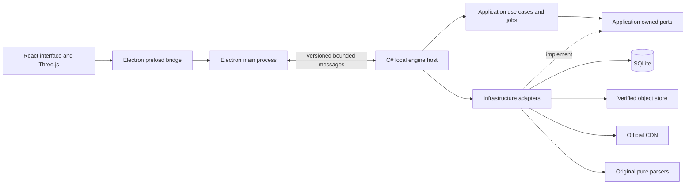

# VibeMiner architecture

VibeMiner has a browser-based desktop interface and one application-owned C# engine. The engine is a modular monolith: use cases and pure parsers remain testable independently of Electron and concrete storage. Do not add a service framework, network server, event bus, or plugin framework without an actual need.

## Process ownership

Electron main owns windows, native dialogs, engine launch, exit handling, and IPC routing. The renderer owns presentation, navigation, and GPU rendering; it has no general Node/filesystem access. Preload exposes narrow operations through context isolation, not arbitrary IPC, SQL, HTTP, or path access.

C# owns source discovery, acquisition, exact build contexts, parsing, job scheduling, SQLite, shared object publication, indexes, comparisons, and asset preparation. It returns bounded projections and approved asset handles, not live database connections or arbitrary local paths.

## Backend locations and dependencies

| Location | Responsibility | Allowed production dependencies |
| --- | --- | --- |
| `VibeMiner.Domain` | Identities, invariants, provenance, readiness/capability values | Platform base types only |
| `VibeMiner.Application` | Use cases, jobs, policies, query projections, outbound ports | Domain |
| `VibeMiner.Protocols.Tact` | Original bounded configuration, BLTE, EN, IN, DL, DS, and locator parsing | Domain where shared identities are needed |
| `VibeMiner.Formats.Wow` | Original WoW ROOT, DB2, schema interpretation, and staged asset decoding | Domain and pure protocol primitives when justified |
| `VibeMiner.Infrastructure` | HTTP, SQLite, CAS, schema resources, and orchestration adapters | Application, Domain, pure parser modules |
| `VibeMiner.Host` | Local process entry, protocol translation, dependency composition, resource lifetime | Application and concrete adapters |

Keep responsibilities cohesive; split a DB2 or asset project only when a concrete boundary merits it. `tests/contracts/architecture.test.mjs` enforces the project dependencies above.

Pure parsers consume bounded caller-provided bytes or streams and return records/completion facts. They never fetch dependencies, discover paths, perform SQL, decide retention, or claim acquisition provenance. Transport-independent application results contain no Electron, HTTP response, SQLite, or parser implementation types.

## Async execution

Network and file I/O use asynchronous APIs with propagated cancellation. CPU parsing and synchronous SQLite operations execute outside renderer, main-process orchestration, and engine request dispatch. Use bounded execution resources and buffered/batched outputs; avoid one task, database connection, or message per file/row. See [async and jobs](ASYNC-AND-JOBS.md).

Shared downloads have independent consumers. View cancellation withdraws that consumer; the underlying operation stops only when its ownership policy permits. Stale completions cannot mutate a different product/build/locale or navigate a detached view.

## Communication

The engine speaks versioned, bounded NDJSON over stdin/stdout ([contracts](../contracts/README.md)): version negotiation, requests/replies, staged progress, cancellation, typed errors and shutdown. C# stdout is protocol-only; logs go to stderr. The Electron client validates payloads against the canonical schema even though TypeScript types are generated from it.

Never stream large binary assets as JSON/base64 or send whole catalogs to the UI. Small metadata uses IPC. Binary payloads (icon PNGs, VMG1 geometry) go through main-owned custom protocols backed by short-lived engine leases; see [Electron boundary](#electron-boundary). Neither process exposes arbitrary filesystem access.

Host frame budgets (1 MiB general; 512 KiB for classifications, creatures and effects; 64 KiB for geometry) must count the worst-case JSON-escaped request ID (128 characters × 6 bytes), the envelope and the trailing newline, not just the payload.

`System.Text.Json` writes a `float` with its shortest Single spelling, for example `0.1`. JavaScript parses that as the double 0.1, which is not `Math.fround(0.1)`. Widen Float32 values to `double` before serializing them so the renderer receives the exact Float32 value.

## Model rendering

Original C# decoders resolve supported model dependencies and produce renderer-oriented data. Three.js renders in the Electron browser renderer. WoW materials, appearance choices, animations and missing dependencies stay explicit; glTF export is not assumed to preserve all game effects.

Creature source geometry is published as a verified VMG1 artifact ([geometry contract](../contracts/creature-geometry-v1.md), [VMG1 format](../contracts/geometry-vmg1-v1.md)). It is geometry only: materials, pose, visibility and appearance are unevaluated. Memory budgets: a 64 MiB C# geometry payload ledger (48 MiB per producer, of which 32 MiB for original model/SKIN sources and 16 MiB for captured context; 8 MiB per reader); model and SKIN sources at most 4 MiB encoded and 8 MiB decoded; a 16 MiB desktop envelope per presentation phase; artifact at most 2 MiB. The 16 MiB envelope counts reachable app buffers, graphics reservations and active responses, not Chromium/driver RSS. The geometry view is built but not wired into the app yet.

## Storage and composition

One runtime owns the SQLite catalog and immutable object store. Multiple builds retain references to shared physical content. Only bootstrap composes concrete adapters; no second cache or downloader is created by a screen, table provider, portrait generator, or export action.

Keep database commits and filesystem publication as separate recoverable resources. Revalidate retained evidence before reporting readiness. Persist long-lived retention intent; reconstruct resumable work from validated checkpoints rather than saved UI percentages.

## Size-first opening and targeted lookup

Production opening uses [home-download-v1](../contracts/download-v1.md): authenticated configurations plus DL scope sizing, with conditional native EN bootstrap. An original bounded external sorter publishes an immutable full-EKey/size ledger; SQLite retains its source association, descriptor and dated reuse assessment. It does not expand ROOT/IN/DS or wait for legacy staging cleanup. Existing complete research catalogs retain their original readiness semantics.

EN native page lookup and bounded targeted ROOT scans are independent pure parser capabilities. Retained decoded EN artifacts authenticate their source binding before use. A pure bounded 128-ID batch helper preserves every requested membership through complete ROOT grammar/EOF; caller policy and authenticated source association stay separate. Feature dependencies resolve through these without a whole-game SQL graph.

## Shared acquisition and durable retention

Host composes one acquisition coordinator, pinned source-plan registry and resource gates. Physical identity is full EKey/exact length/verifier; source authority and feature CKey/locale interpretation stay separate. Authenticated archive footer/TOC/page proofs share bounded caches and in-flight requests. A sealed DL-scoped compact map amortizes bulk location; a nonmember never inherits that map's negative result. Source leases pin original observation/configuration evidence across refreshes.

SQLite stores bounded durable intents, receipt aliases, native-source checkpoints, generation-fenced presence/problem state and compact historical ledger coverage bit pages. One feeder holds at most 32 subscriptions, one validated ledger and one map session; it never hashes or parses full maps per object. Pause/On demand withdraw only that job's consumers, while shutdown preserves intent. Read/list return local snapshots without driving work. Historical receipt credit, dated stat presence, actual current cryptographic verification and decoded readability remain different evidence.

Actual corruption is recorded centrally while serialized with same-SHA repair; publication can atomically replace an existing bad encoded object only after independent complete incoming encoded/SHA verification. A monotonic durable epoch prevents an earlier successful proof from clearing a newer corruption observation. CAS replacement and receipt/credit commits remain separate resources. Progress callbacks coalesce; reliable subscription payload counters provide accounting independently of presentation delivery. See [retention wire](../contracts/retention-v1.md) and [async and jobs](ASYNC-AND-JOBS.md#background-retention-worker).

## Table records on demand

`tables.prepare` uses the shared acquisition/CAS primitives to resolve the selected provider FileDataID through authenticated EN and targeted ROOT, preserving exact enUS memberships. Required archive location authenticates small native index proofs with four bounded workers and reuses successful proofs. It does not build a whole-game SQL graph. An original bounded WDC5 reader matches actual table/layout headers to the exact build-selected pinned definition before admitting records.

Rows stream into one immutable artifact with a sorted ID directory. SQLite stores small content/locator/interpretation registrations and exact source-context/locale admissions. Bounded pages preserve exact string values and may filter a raw record ID. A shared producer separates presentation navigation from explicit cancellation; last-consumer cancellation and shutdown await cleanup. An authenticated BLTE projection can expose readable chunks while refusing every read across encrypted holes. WDC5 admits it only when required metadata is readable and holes lie wholly inside excluded protected sections. Complete encoded retention and partial decoded/readable coverage have distinct proof identities; full decoded CKey verification is never claimed. Unverified wider integer columns retain explicit whole-column physical interpretation and suppress inferred references. Partial exclusions remain distinct from absent memberships, unsupported structures and corruption. See [the table-data contract](../contracts/table-data-v1.md).

Reference text ([contract](../contracts/table-reference-text-v1.md)) is a local, batched read for one row page: the engine reads the page, resolves allowlisted references against already admitted text tables through up to four dedicated verified readers, and reports an unprepared text table instead of acquiring it. The desktop prepares that table through `tables.prepare`, automatically when it is at most 1 MiB encoded and otherwise on Load text, and asks again.

## Electron boundary

Main never trusts renderer-supplied build data, paths or URLs. The renderer names an exact saved identity; C# resolves and pins the observation, routes and receipts itself.

The app window uses context isolation, sandbox and no Node integration, in the default session. Custom protocol handlers are registered on that session only.

**Icons (`vibeminer-image://icon/<id>`).** Registered with `standard` and `secure` privileges only: no fetch API, no service workers, no CSP bypass. C# reauthorizes the exact Item/source admission; main copies the approved PNG into a private snapshot, checks its SHA-256 and streams the snapshot. Bounds ([icon-image-protocol.ts](../apps/desktop/src/main/icon-image-protocol.ts)):

| Bound | Value |
| --- | --- |
| Live grants | 200, each valid 2 minutes |
| Requests | 64 admitted: 4 active, 60 waiting |
| Body deadline | 10 s per request |
| PNG size | 5 MiB |

All grants are revoked when the main-frame document changes, the renderer process goes away or the engine becomes unavailable. Revocation stops future delivery; it cannot erase pixels Chromium already has. Chromium keeps its own copy of delivered images (encoded and decoded) in addition to main's snapshot, so count both when sizing memory. Load only visible images and unmount offscreen ones.

**Geometry (`vibeminer-geometry://body/<capability>`).** Registered with `standard`, `secure`, fetch and CORS support. Each URL is a single-use capability for one verified VMG1 body, valid 30 s; at most 2 bodies may be opening or retiring and 1 active. Only plain `GET` is served: no range, cookies or authorization headers. See the [geometry contract](../contracts/creature-geometry-v1.md).
